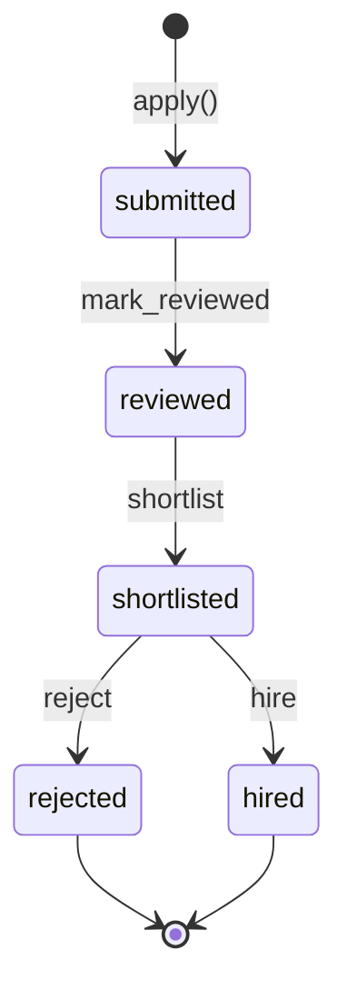
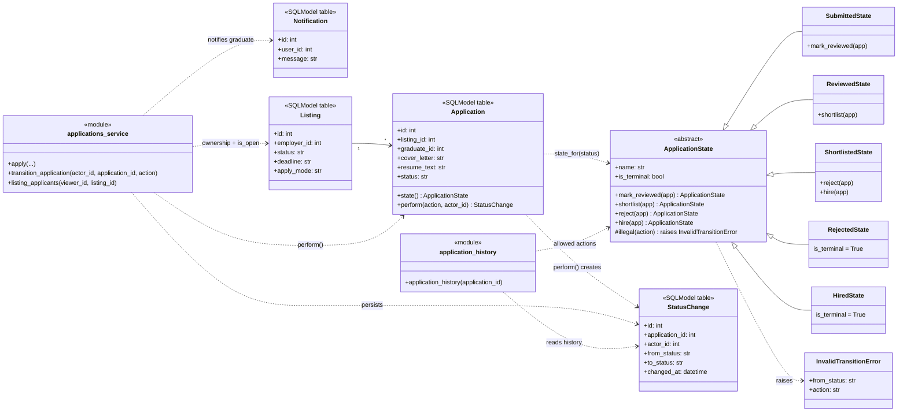

# Pattern evidence: State pattern for the application lifecycle

The starter tracked an application with a `status` string **and** four boolean
flags (`flag_reviewed`, `flag_shortlisted`, `flag_rejected`, `flag_hired`),
updated through nested conditionals in `app/services/lifecycle.py`. The two
could disagree, illegal jumps were allowed (e.g. `submitted → hired`), and the
graduate view read the flags while employers saw the column.

The team replaced this with the **State pattern**: one object per status, each
of which knows only the moves it allows. `status` is now the single source of
truth, and every move is recorded.

## Lifecycle

Any other action from any state raises `InvalidTransitionError` (HTTP 409).
`rejected` and `hired` are terminal; there is no `reopen`. A rejected graduate
may apply again, which creates a new application.

## Class diagram

Layering is unchanged from FastStart: `routers/board.py` → `services/*` → models.

## File-by-file

| File | Role in the pattern | Introduced |
|---|---|---|
| `app/services/application_states.py` | **State hierarchy.** `ApplicationState` (abstract) defines every action as illegal by default; each concrete state overrides only its legal moves and returns the next state. `STATES` holds one shared instance per status; `state_for(status)` looks one up. | #1 |
| `app/models/application.py` | **Context.** `Application.status` is the only lifecycle field (flags removed). `state()` returns the current state object; `perform(action, actor_id)` delegates to it, updates `status`, and returns a `StatusChange`. | #2 |
| `app/models/status_change.py` | **Audit record** of every move: who, from, to, when. | #2 |
| `app/services/applications.py` → `transition_application` | **Use case.** Checks the actor is the listing's employer (AC12), blocks submitted/reviewed changes on closed listings, calls `perform()`, then saves the `StatusChange` and a `Notification` to the graduate in one commit. `InvalidTransitionError` → 409. | #5 |
| `app/services/application_history.py` | **Read side.** Asks the current state which actions are allowed and returns the `StatusChange` history; shown to employers on the applicants route. | #5 |
| `app/routers/board.py` | Thin HTTP layer: maps the service `status_code` to the response. | #2, #3, #5 |
| `app/services/lifecycle.py` | Old flag-based tracker. **Removed.** | removed in #5 |

## Why State (and not a transition table)

- Each status's rules live in one small class, so adding a status or action
  means adding a class or one method, not editing a nest of `if`s.
- Illegal moves are the default (`illegal()` in the base class), so a new action
  is safe until a state explicitly allows it.
- `Application.perform()` keeps callers from setting `status` directly, and the
  returned `StatusChange` makes auditing part of every move.
- A plain dict of `(status, action) → status` would be shorter, but it has no
  place for per-state behaviour (e.g. `is_terminal`, future side effects).

## Tests that evidence it

| Behaviour | Test |
|---|---|
| Every legal and illegal transition, terminal states | `tests/test_states.py` |
| `perform()` updates status, builds `StatusChange`; illegal move leaves status unchanged | `tests/test_models.py` |
| Owner-only transition persists `StatusChange` **and** `Notification` | `tests/test_transitions.py::test_listing_owner_can_transition_and_persists_change_and_notification` |
| Illegal/unknown actions persist nothing | `tests/test_transitions.py::test_every_illegal_transition_is_refused_without_persistence`, `::test_unknown_action_returns_400_without_persistence` |
| Allowed actions and history on applicants route | `tests/test_transitions.py::test_applicants_include_state_actions_and_status_history` |
| End-to-end via HTTP: legal path, no jumps, terminal is final, one consistent status | `tests/test_acceptance.py::TestAC10Lifecycle`, `::TestAC11ConsistentStatus`, `::TestAC12OnlyListingEmployerTransitions` |
